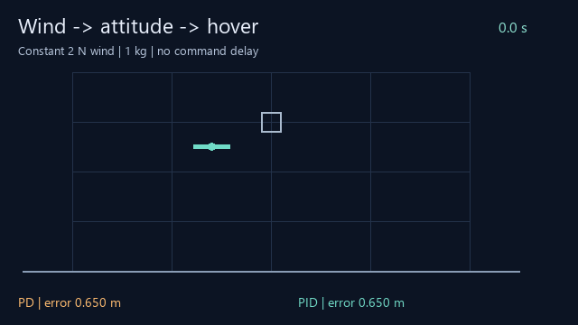

# drone-hover-lab · 无人机怎样在风中站稳？

[English](README.en.md) · [打开演示](https://flessnerchernosky-ops.github.io/drone-hover-lab/?lang=zh) · [实验路线](ROADMAP.md)

让两架二维无人机在同样的风中悬停。比较只纠正当前误差的 PD 与记住累积误差的 PID；观察持续风、阵风、额外载荷和延迟怎样影响飞行。



**无需硬件、注册或付费。** 下载仓库后直接打开 `docs/index.html`，或使用在线演示；界面和指南均为中英双语。浏览器不向服务器上传实验数据，CSV 在本机生成。

## 3 分钟开始

1. 打开演示，点击“运行到底”，看两种方法的分数。
2. 只改变一个参数，例如延迟，然后重跑；场景切换会重置实验轨迹，语言切换会保留结果。
3. 下载 CSV，写一句带证据的结论。完整运行才能导出，元数据包括设置、步长和完成状态。

## 一组真实结果

默认 wind、零延迟、2 N 风力、1 kg 质量，未删除初始过程：

| 方法 Method | 全程 RMSE / Full-run RMSE (m) | 末段 / Late RMSE (m) |
|---|---:|---:|
| PD / PD | 1.051069 | 1.111110 |
| PID / PID | 0.358667 | 0.002226 |

阵风场景中，末段误差 PD 0.516 m、PID 0.656 m：PID 更差。默认 0.2 s 延迟场景两者均触地。

数据来自 [benchmarks.json](benchmarks.json) 的 15 组配置 / 30 条轨迹。已保存默认完整原始轨迹 [trace.csv](trace.csv)，其他场景可从浏览器导出或用模型生成。这些是确定性结果，不是随机重复的统计结论；相同数据重复计算不能增加证据强度。误差阈值、时间窗口和模型假设都影响结果。

## 本地复现

需要 Node.js 18+ 和 Python 3.9+，核心实验仅用标准库，无需安装 Python 包或 npm 依赖。在仓库根目录运行：

```sh
node test.cjs
node benchmark.cjs --check
python verify.py
```

17 项模型检查、完整基准核对以及 Python 独立几何/指标审计。修改模型后，运行 `node benchmark.cjs` 生成新基准；请在提交中说明参数和算法变动，保留失败场景。可选 `python -m http.server 8000 --directory docs` 后访问 `http://localhost:8000`。

可选重建预览图：安装 Pillow（`python -m pip install Pillow`），运行 `python build_preview.py`。动图取样自默认 CSV；字体及 Pillow 版本可能影响图像字节，核心数值不受影响。

## 实现和边界

- 状态：`[x,z,vx,vz,θ,ω]`，真实质量可调，控制器固定假定质量 1 kg。目标 `(0,1.5)` m，初始 `(-0.6,1.25)` m，其余状态为零。
- 动力学：`m ẍ=−T sinθ+F_w−0.15vx`，`m z̈=T cosθ−mg−0.15vz`；`θ̈=0.2(f_R−f_L)/0.025−0.1ω`，g = 9.81。单个旋翼推力在 [0,9] N。
- 外环：`a_x=1.8e_x−2.6vx+0.7I_x`、`a_z=4e_z−3vz+1.8I_z`，PD 去掉积分项。`θ_ref=clip(atan2(−a_x,g+a_z),±0.45)`；`T=(g+a_z)/max(0.5,cosθ)`。
- 内环：`τ=0.025[36(θ_ref−θ)−12ω]`，分配为 `(T∓τ/0.2)/2`，再限幅。积分限幅 ±3；若旋翼分配或目标倾角饱和，冻结两个积分器。这是简单的条件积分策略。
- 指令队列先填入每个旋翼 4.905 N 的悬停推力。步内风力和推力常值，RK4，dt = 0.005 s。持续横风默认 2 N，阵风为 `2[sin(1.2t)+0.4sin(3.1t)]` N，阵风场景里的风力设置是幅度而非峰值。
- 每次 20 s，末段指标使用 (15,20] s；接近阈值 0.1 m。触地后固定高度 0、速度清零、后续推力清零，失败后的误差仍计入全过程指标。
- 无状态估计：控制器直接读取真值。未包含三维空气动力学、真实飞控、传感器噪声和强化学习。只适合教学及控制对照仿真。

RMSE 为等时间采样的欧氏位置误差均方根；末段误差使用上述末段窗口。近目标秒数是累计满足半径阈值的时间，不等于成功抓取或任务完成。推力平方积分仅是控制努力代理量，不等于实际电能。

| File | Purpose / 用途 |
|---|---|
| `docs/index.html`, `app.js`, `style.css` | Bilingual browser UI / 双语交互 |
| `docs/engine.js` | Shared browser/Node model / 同一计算模型 |
| `test.cjs` | 17 meaningful model checks / 17 项模型检查 |
| `benchmark.cjs`, `benchmarks.json` | Reproducible paired study / 可复现对照 |
| `trace.csv`, `verify.py` | Raw default run + independent audit / 默认原始数据与独立审计 |
| `build_preview.py` | Optional GIF/cover regeneration / 可选重建动图及封面 |
| `ROADMAP.md` | Research extensions / 研究拓展 |


## 怎样发展成申请作品

先亲自复现，并独立解释一组成功和一组失败。再完成 [ROADMAP.md](ROADMAP.md) 中一个受控实验，展示你的修改、调参预算、独立评估场景和结论。论文式命名与星数不能替代你对代码和实验的理解。代码与初始文档由 AI 辅助生成；请在申请材料中说明你的实际贡献与验证工作。

## 参考、贡献与许可

[gym-pybullet-drones](https://github.com/learnsyslab/gym-pybullet-drones) 提供基于 PyBullet 的无人机控制环境，[PX4 官方仿真指南](https://docs.px4.io/main/en/simulation/) 描述更接近飞控的仿真工作流。它们是后续拓展参考；当前版本独立编写二维模型，没有集成 PyBullet 或 PX4。

欢迎按 [CONTRIBUTING.md](CONTRIBUTING.md) 改进教学案例、可访问性和实验分析。如果实验对你有帮助，欢迎 Star 或分享具体发现。MIT License，见 [LICENSE](LICENSE)。
